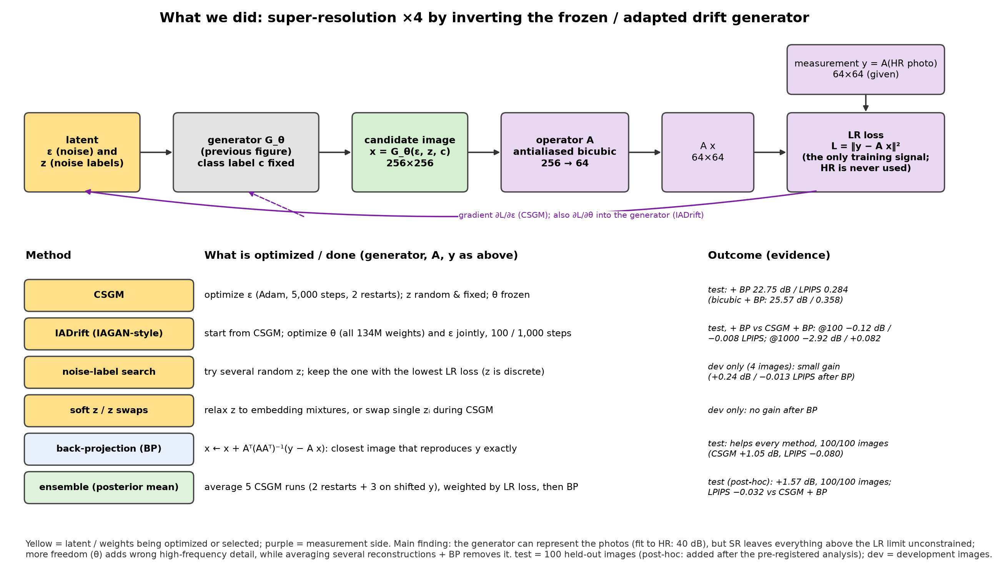

# IADrift: image-adaptive inversion of a drifting model

Aviram Ohayon and Ziv Moshe. Final project, Advanced Topics in Signal and Image Processing (83891), Bar-Ilan
University.

- Report (7 pages): [`docs/report.pdf`](docs/report.pdf)
- Full report, with everything we tried: [`docs/extended_report.pdf`](docs/extended_report.pdf)
- Test protocol: [`docs/PROTOCOL.md`](docs/PROTOCOL.md)

Image-Adaptive GAN (IAGAN; Abu Hussein, Tirer and Giryes, AAAI 2020) fine-tunes a GAN's weights on each test
measurement, to lower the representation error of the prior. We port this recipe to a pretrained one-step drifting
model, `pixel_B_sota` ([Deng et al., 2026](https://arxiv.org/abs/2602.04770)), and test it on noiseless ×4
super-resolution (64×64 → 256×256) of ImageNet-V2. A drifting generator has no low-dimensional latent: its input is
image-sized Gaussian noise ε plus 32 discrete style labels. The labels are called `z` (or `noise_labels`) in the
code and *s* in the report.

We compare three things, each followed by back-projection (BP) onto the images consistent with the measurement:

- **CSGM**: freeze the generator and optimize ε;
- **IADrift**: start from the CSGM solution and also adapt the weights (our port of IAGAN);
- **ensembles**: average several CSGM reconstructions, as an approximate posterior mean.



## Results

100 held-out test images, all after BP.

| Method | PSNR (dB) ↑ | LPIPS ↓ |
|---|---:|---:|
| bicubic | **25.57** | 0.358 |
| CSGM | 22.75 | 0.284 |
| IADrift, 100 steps | 22.63 | 0.276 |
| IADrift, 1,000 steps | 19.83 | 0.366 |
| Ens-W: 5 CSGM runs, weighted by measurement fit | 24.32 | 0.252 |
| Ens-U: the same 5 runs, uniform mean | 24.88 | **0.247** |

The IADrift tests were fixed before any IADrift test run ([`docs/PROTOCOL.md`](docs/PROTOCOL.md)). The ensemble came
later, from development work, and was tested under a dated addendum (Section 11), with Ens-W as its primary method.

In short: on this prior CSGM is perceptually better than bicubic but less accurate. Adapting the weights keeps lowering
the measurement loss while the image gets worse, because the measurements say nothing about the null space of the
downsampling operator, where the updates put invented detail. Averaging reconstructions removes much of that detail.

## Layout

```
iadrift/            the library: operator and BP, generator calls, CSGM, IADrift, ensembles, metrics, statistics
scripts/data/       prepare_data.py: ImageNet-V2, measurements, split, test sample
scripts/test/       the test-set runs (CSGM, IADrift, ensemble) and an overnight driver
scripts/dev/        the development experiments (development images only)
scripts/analysis/   from raw runs to results/: BP, LPIPS, statistics
scripts/report/     from results/ to the report's figures and numbers
results/            the compact results the report is built from (metrics, traces, a few example images)
figures/            method diagrams, and figures/report/ with the report figures
docs/               the reports and the test protocol
```

## Installation

Python 3.12. The report figures and tables need only the CPU:

```bash
python3.12 -m venv .venv && source .venv/bin/activate
pip install -r requirements.txt
```

The experiments need Linux and a CUDA 12 GPU with about 16 GB, plus the upstream drifting code:

```bash
pip install -r requirements-experiments.txt
git clone https://github.com/lambertae/drifting third_party/drifting
git -C third_party/drifting checkout accd0cf09c33b70892d33941d2a287ca86cb92e1   # the commit we used
pip install -r third_party/drifting/requirements.txt
```

Paths are set by environment variables:

| Variable | Default | Contents |
|---|---|---|
| `IADRIFT_DATA` | `data/ImageNetV2` | ImageNet-V2, the measurements, and all experiment caches |
| `DRIFTING_DIR` | `third_party/drifting` | the upstream drifting code |
| `IADRIFT_HF_CACHE` | `hf_cache` | the `pixel_B_sota` weights, downloaded from Hugging Face on first use |

## Reproducing the report

**From `results/` (CPU, about a minute).** Every table and number in the report, and its figures:

```bash
python scripts/report/report_numbers.py      # Tables 1-3, and the numbers quoted in the text
python scripts/report/make_figures.py        # figures/report/*.pdf
```

The two example figures of the late-stage ensembles (`z_iad_examples`, `z_ensemble_examples`) also need
`results/z_ensemble_examples.npz`, which `scripts/analysis/export_z_ensemble_results.py` writes from the development
caches. The method diagram of the full report is `figures/methods_overview.pdf`.

**From scratch (GPU).** Every runner has `--help`, a `--dry-run` that only reports what is cached, and resumes where
it stopped.

1. Data, about 10 minutes:

   ```bash
   python scripts/data/prepare_data.py
   python scripts/data/prepare_data.py --check
   ```

2. Test set (timings on an RTX A4000):

   | Result | Command | Runs, time |
   |---|---|---|
   | CSGM, correct and wrong label | `bash scripts/test/run_overnight.sh csgm` | 400, ~7.5 h |
   | IADrift @100 / @1000 | `bash scripts/test/run_overnight.sh iadrift` | 200, ~3.5 h |
   | Ensemble (protocol addendum) | `bash scripts/test/run_overnight.sh ensemble` | 300, ~5.5 h |
   | BP, LPIPS, statistics | `python scripts/analysis/evaluate_test.py --part all` | CPU, ~30 min |
   | `results/` | `python scripts/analysis/export_results.py`, then `export_ensemble_results.py` | CPU |

3. Development experiments, one runner each in `scripts/dev/`:

   | Experiment | Runner | Used in |
   |---|---|---|
   | CSGM settings sweep, 100 images | `run_csgm_settings_sweep.py` | report Sec. 3.1 |
   | IADrift learning rates, the step-100 checkpoint | `run_iadrift_dev.py` | report Sec. 3.2 |
   | CSGM on the development images | `run_csgm_dev.py` | Table 2 |
   | Fitting the HR image (CSGM-HR, IADrift-HR) | `run_representation_dev.py`, `run_hr_fit_dev.py` | Table 2, full report |
   | θ-only adaptation | `run_theta_only_dev.py` | Sec. 3.2, Table 2 |
   | In-range targets, generator samples | `run_representation_dev.py`, `run_generator_samples_dev.py` | Table 2 |
   | What z and ε control; an image in place of ε | `run_noise_label_role_dev.py`, `run_image_in_eps_dev.py` | full report |
   | ε kept on the Gaussian shell | `run_eps_projection_dev.py` | Table 2 |
   | Label search | `run_noise_label_search_dev.py`, `run_z_swap_confirm_dev.py` | Table 2 |
   | Ensembles of CSGM and of IADrift runs | `run_ensemble_dev.py`, `run_iadrift_ensemble_dev.py` | Table 3 |
   | Larger ensembles, shorter runs | `run_z_ensemble_dev.py` | Appendix A |
   | Colour penalty and frequency anchor | `run_hf_constraints_dev.py` | full report |

   Some runners start from others' outputs. Run `run_csgm_settings_sweep.py` first (it fixes the development images),
   then `run_csgm_dev.py` and `run_z_swap_confirm_dev.py`, then `run_ensemble_dev.py`, then
   `run_iadrift_ensemble_dev.py` and `run_hf_constraints_dev.py --a` before `--b`. `run_representation_dev.py` comes
   before `run_hr_fit_dev.py` and `run_generator_samples_dev.py`. The rest need only `run_csgm_dev.py`, or nothing.

   Then rebuild `results/` with `scripts/analysis/export_dev_results.py`, `export_ablation_results.py` and
   `export_z_ensemble_results.py`, in this order (the last reads `results/ablation_metrics.json`).

## Numerics

The generator computes in bf16 and the optimizations are chaotic, so a rerun matches a saved run bit for bit only
with the same software and GPU settings. Each runner sets them itself (`iadrift.runtime.setup`):

- CSGM-type runs use JAX's default GPU allocator.
- Runs that differentiate with respect to the generator weights (IADrift, θ-only, HR fit, penalties) use
  `XLA_PYTHON_CLIENT_ALLOCATOR=platform`, since the default allocator hangs under WSL2, and
  `XLA_FLAGS=--xla_gpu_deterministic_ops=true`. Without the flag two identical runs can pick different kernels.
- Keep the two kinds of run in separate processes.

`--smoke` (or `--repro-check`) reruns part of a saved run and compares it with the cache. On an RTX A4000 (JAX 0.4.37,
CUDA 12) all of them match exactly, except `scripts/dev/run_iadrift_dev.py`. That learning-rate grid was our first
IADrift run, made before we added the deterministic flag, so its smoke test only checks agreement within the observed
run-to-run variation (≤ 0.1 dB PSNR). The `--check` modes of `prepare_data.py`, `evaluate_test.py`,
`export_results.py`, `export_ensemble_results.py` and `export_dev_results.py` recompute their outputs and compare
them with the saved files (identical). `export_ablation_results.py --check` compares within float tolerances
(relative 1e-4 for metrics, absolute 2e-3 for the float16 images), because its saved files were made on another
machine.

## Data and license

[ImageNet-V2](https://github.com/modestyachts/ImageNetV2) (MatchedFrequency) is not included. Besides metrics,
`results/` holds a few 256×256 crops derived from it (the first 4 test images and some development images, float16)
so that the figures can be drawn. They are included for research and illustration only and remain under the
ImageNet / ImageNet-V2 terms of use. Our code is MIT-licensed (`LICENSE`). The pretrained generator and its code
belong to their authors.

## References

- A. Bora, A. Jalal, E. Price, A. G. Dimakis. *Compressed Sensing using Generative Models.* ICML 2017.
- S. Abu Hussein, T. Tirer, R. Giryes. *Image-Adaptive GAN based Reconstruction.* AAAI 2020.
- M. Deng, H. Li, T. Li, Y. Du, K. He. *Generative Modeling via Drifting.* arXiv:2602.04770, 2026.
- R. Zhang, P. Isola, A. A. Efros, E. Shechtman, O. Wang. *The Unreasonable Effectiveness of Deep Features as a
  Perceptual Metric.* CVPR 2018.
- B. Recht, R. Roelofs, L. Schmidt, V. Shankar. *Do ImageNet Classifiers Generalize to ImageNet?* ICML 2019.
